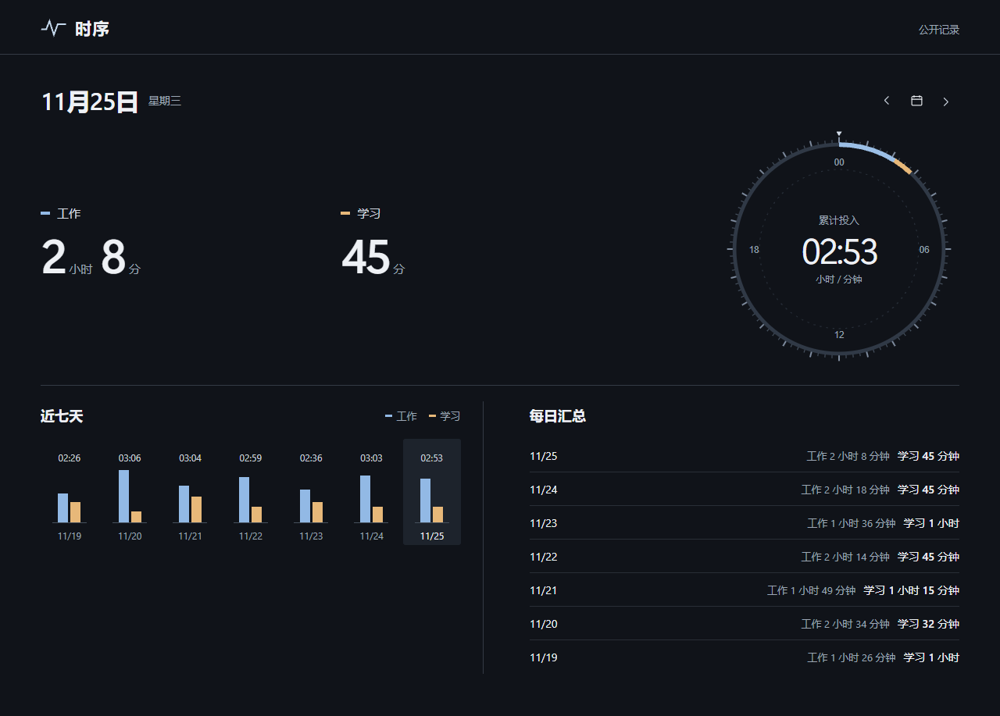
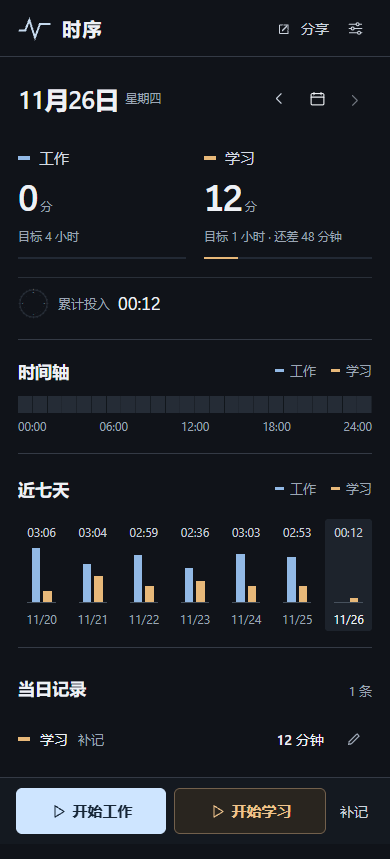

# 时序

时序用来记录每天工作了多久、学习了多久。你可以在电脑上开始工作，用手机结束同一段计时。忘了点开始，也可以事后补记。

[查看公开展示页](https://time-ledger.mildaphid8.chatgpt.site/share) · 无需登录，可查看每日工作和学习时长，以及最近七天的变化。

  
  

电脑端展示每日汇总，手机端随手计时。截图使用示例记录，点击可查看大图。

## 本机使用

个人记录页位于 `/`，只读展示页位于 `/share`。按北京时间汇总。补记数据保留原始日期和分钟，计时记录保留毫秒精度的起止时间。

需要 Node.js 22.13 或更新版。在项目目录运行 `node selfhost/server.mjs --local`，打开生成的 `outputs/local-data/打开我的时序.url`。本地数据和登录密钥保存在该目录。默认监听 127.0.0.1:4186。这个快捷方式用于个人登录。

## 自有服务器

在部署环境设置 `OWNER_PASSWORD`（长随机密码）和 `PUBLIC_ORIGIN`（含 HTTPS 的最终站点地址），运行 `docker compose up -d --build`。通过 HTTPS 反向代理访问本机 8080 端口。SQLite 存储在持久卷 `shixu-data`。两种运行方式共用同一套页面、统计和事务逻辑。

## 从 Sites 迁回

1. 在新服务器启动空实例，用自己的站主密码登录。
2. 旧站「设置 → 备份与迁移」选择「设为只读」并下载完整备份。正在运行的记录保留原始起点。
3. 新站「设置 → 备份与迁移 → 从备份恢复」选择 JSON。恢复只写入空记录库，同一事务导入所有记录和目标。再下载新站备份，用 `node selfhost/compare.mjs 旧备份.json 新备份.json` 核对。
4. 核对成功后切换书签和分享链接。旧站可保留只读；如需回退，先停止在新站写入，再对照迁移后的新增记录。

## OpenAI Sites

Sites 使用 D1。首次在自己的浏览器打开个人记录链接即可连接设备，此后直接打开首页就能计时。云端 `CLAIM_HASH` 保存个人记录密钥的 SHA-256 摘要；原来的首次启用快捷方式继续可用。要连接手机或另一台电脑，在「设置 → 连接另一台设备」生成有效期 24 小时的一次性链接。已绑定的旧站主身份继续有效。访客打开首页或 `/share` 可以查看按日汇总，访问明细、备份或写入记录需要记录权限。设备凭证不会进入业务数据备份。

## 验证

`node --test tests/ledger.test.mjs` 检查权限、计时切换、重复请求、跨天拆分、备份和恢复。Sites 构建使用 `npm ci` 和 `npm run build`。
